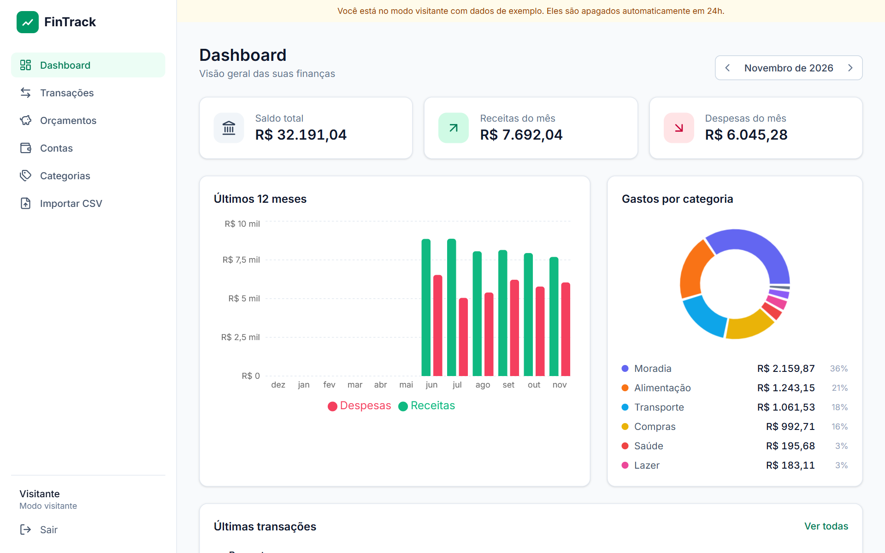
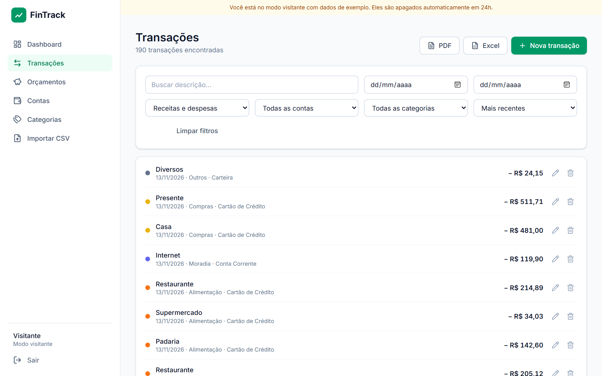
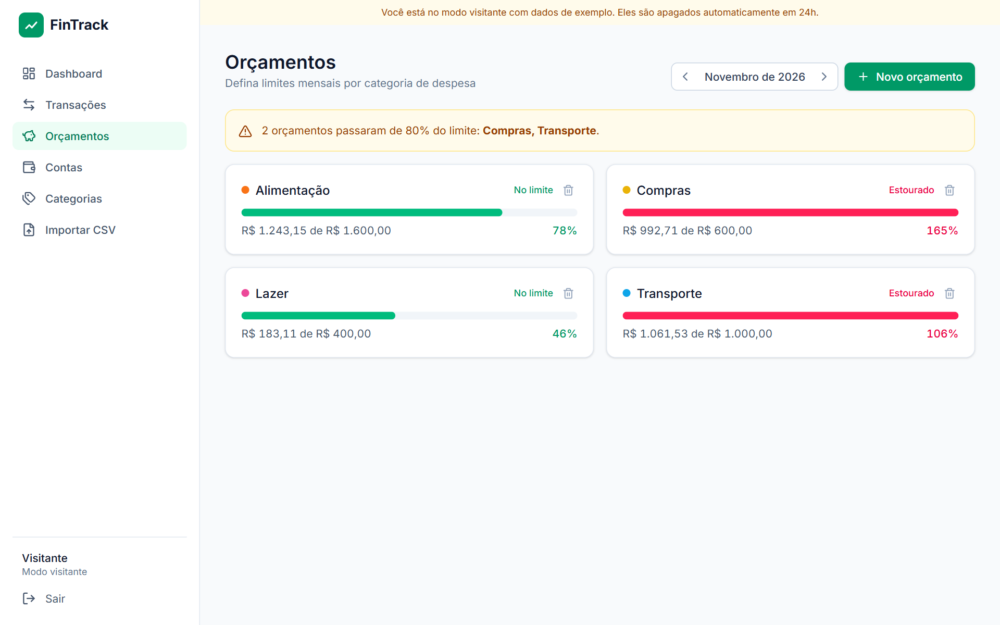
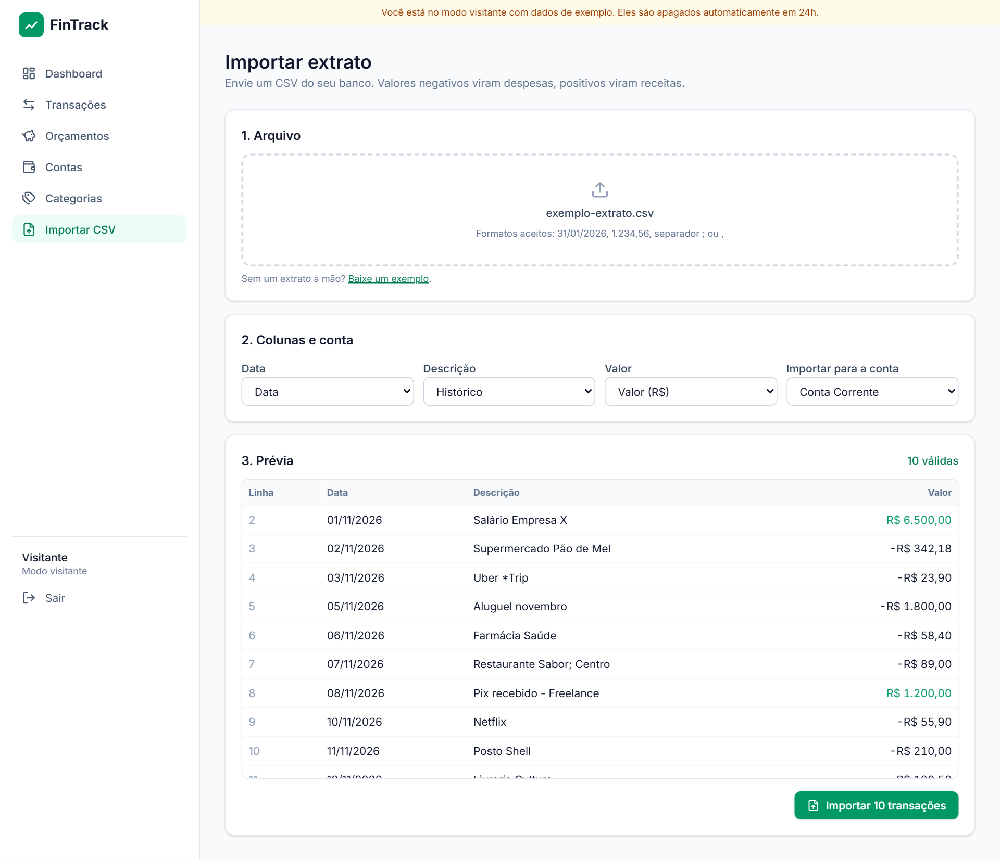
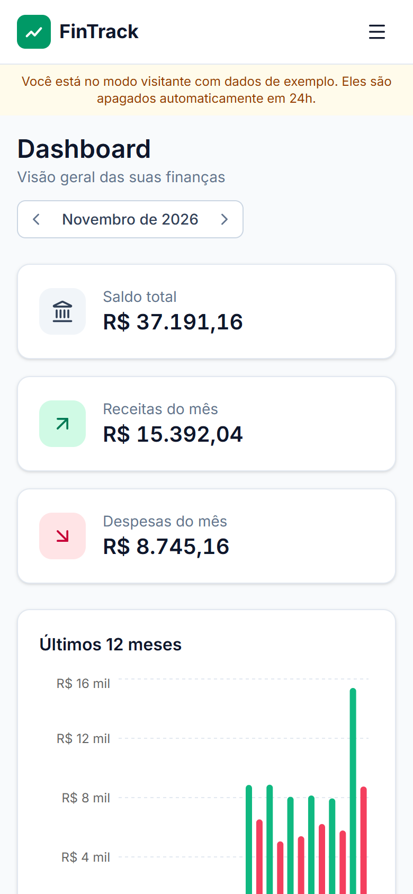
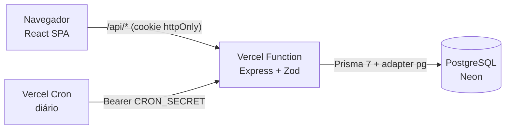

<div align="center">

# 💸 FinTrack

**Controle de finanças pessoais full-stack: dashboards, orçamentos com alertas, importação de extratos bancários e exportação em PDF/Excel.**

[](https://github.com/lucasaccioly/fintrack/actions/workflows/ci.yml)


**[🔗 Acessar a demo](https://fintrack-amber-pi.vercel.app)** · clique em **"Entrar como visitante"** para explorar com dados de exemplo, sem cadastro.



</div>

## ✨ Funcionalidades

- **Dashboard** com saldo consolidado, receitas × despesas do mês, gastos por categoria e histórico de 12 meses
- **Transações** com filtros combináveis (período, conta, categoria, tipo, busca), ordenação e paginação, tudo refletido na URL
- **Orçamentos mensais** por categoria, com alerta ao passar de 80% e de 100% do limite
- **Importação de extrato CSV** com mapeamento de colunas, detecção automática do formato brasileiro (`31/01/2026`, `1.234,56`, separador `;`, Windows-1252) e prévia que destaca linhas inválidas antes de importar
- **Exportação** das transações filtradas em **PDF** e **Excel**
- **Contas** (corrente, poupança, cartão, dinheiro) com saldo calculado e **categorias** personalizáveis
- **Modo visitante**: cada visitante ganha um usuário isolado com 6 meses de dados realistas, removido automaticamente após 24h
- Layout **responsivo**, do celular ao desktop

| Transações | Orçamentos |
|---|---|
|  |  |

| Importação de CSV | Mobile |
|---|---|
|  |  |

## 🏗️ Arquitetura



Monorepo com npm workspaces, publicado como **um único projeto na Vercel** (front estático + API serverless no mesmo domínio):

```
fintrack/
├── web/       React 19 · Vite · Tailwind 4 · TanStack Query · React Hook Form · Recharts
├── server/    Express 5 · Prisma 7 · Zod · JWT · testes de integração (Vitest + Supertest)
├── api/       entrypoint serverless da Vercel (reexporta o app Express)
└── vercel.json
```

## 🧠 Decisões técnicas

- **Dinheiro em centavos (inteiros)** no banco, na API e no front. Nada de `float` para valores monetários; a formatação em R$ acontece só na tela.
- **Isolamento por usuário em toda consulta.** Acessar o recurso de outro usuário retorna `404` (não `403`), para não revelar que o ID existe. Há testes para isso em todas as rotas.
- **Datas como `DATE` do Postgres**, sempre lidas e gravadas em UTC: uma transação de 31/01 nunca "vira" 30/01 por fuso horário.
- **Agregações no SQL** (`groupBy`, `date_trunc`/`to_char`) em vez de carregar tudo e somar em JavaScript.
- **Validação com Zod** em toda entrada da API, com erros padronizados `{ error, details }`.
- **Autenticação por JWT em cookie `httpOnly` + `SameSite=Lax`**: o token não fica acessível a JavaScript (mitiga XSS) e o front e a API compartilham o domínio.
- **Integridade**: não é possível excluir conta/categoria com transações (`409`), nem lançar despesa em categoria de receita.
- **Parser de CSV próprio** (RFC 4180) com testes para os formatos que bancos brasileiros realmente exportam.

## 🧪 Testes

```bash
npm test
```

- **API**: testes de integração contra um PostgreSQL real (auth, isolamento entre usuários, filtros, paginação, importação, orçamentos, dashboard e limpeza de visitantes).
- **Front**: parser de CSV, conversão de valores/datas em formato brasileiro, regras de alerta de orçamento.
- **CI**: GitHub Actions roda typecheck, testes e build a cada push.

## 🚀 Rodando localmente

Pré-requisito: **Node.js 22+**. Não precisa de Docker: o projeto sobe um PostgreSQL embutido via npm.

```bash
git clone https://github.com/lucasaccioly/fintrack.git
cd fintrack
npm install
cp .env.example server/.env
npm run db -w server                 # terminal 1: PostgreSQL local na porta 54329
npm run migrate -w server            # cria as tabelas
npm run dev -w server                # terminal 2: API em http://localhost:3001
npm run dev -w web                   # terminal 3: app em http://localhost:5173
```

> Com Docker, `docker compose up -d` substitui o primeiro comando.

## 🌐 Deploy

Demo: **https://fintrack-amber-pi.vercel.app**

Publicado na **Vercel** com banco **Neon** (PostgreSQL serverless). Variáveis de ambiente: `DATABASE_URL`, `JWT_SECRET`, `CRON_SECRET`. As migrações rodam no build (`npm run vercel-build`) e a limpeza de visitantes roda via Vercel Cron.

## 📄 Licença

[MIT](LICENSE) © Lucas Accioly
